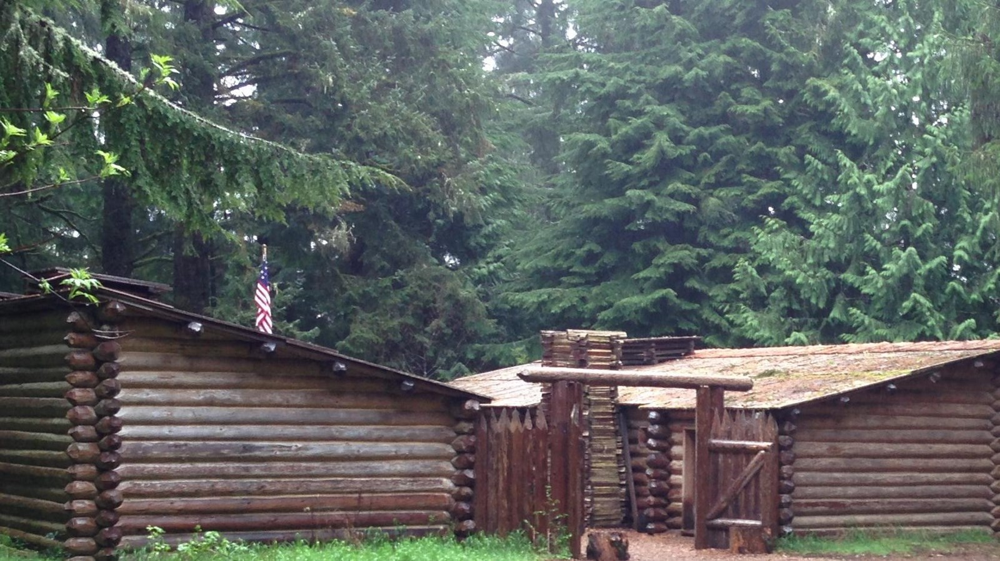

## A journey through inhabited homelands

The expedition traveled through a continent already home to sovereign Indigenous nations, established trade networks, and generations of geographic knowledge. Its mission combined scientific observation with United States commercial and territorial ambitions. [National Archives](https://www.archives.gov/education/lessons/lewis-clark)

### People made the passage possible

Mandan and Hidatsa communities were central to the first winter. Sacagawea and Toussaint Charbonneau joined the expedition at Fort Mandan. Farther west, Nez Perce hosts welcomed the exhausted travelers at Weippe Prairie and shared knowledge of the country. [Fort Mandan](https://home.nps.gov/places/fort-mandan.htm) · [Weippe Prairie](https://www.nps.gov/nepe/learn/historyculture/weippe-prairie-history.htm)

### A winter beside the Pacific

Fort Clatsop sheltered the party during the rainy winter of 1805–1806. Preparing provisions and organizing records occupied the months before the March departure. The building visitors see today is a reconstruction. [National Park Service](https://www.nps.gov/places/fort-clatsop-or.htm)

*Modern Fort Clatsop replica. Image: National Park Service.*

### How to read this map

The basemap uses the supplied **Natural Earth 1:10 million** land, lake, and river datasets. These depict generalized modern geography; river channels, reservoirs, and coastlines are not a reconstruction of 1804. Natural Earth data is [public domain](https://www.naturalearthdata.com/about/terms-of-use/).

Colored dashed lines connect selected outbound waypoints. They are **schematic**, do not follow every river bend, and omit the separate 1806 return branches. The timeline includes the return. Markers are approximate geographic anchors, not exact campsites. In particular, Fort Mandan’s original location is uncertain.

Shaded regions are optional editorial focus areas, not tribal territories or historical boundaries. This is a reading map, not a hiking or navigation guide.
